# Example custom faces

32 faces to use as they are, adapt, or learn the format from. Each is a JSON file to
push to the clock (`POST /api/faces`, or `python clock.py push <name> <file>` from the
Claude Code skill); the format is in
[docs/specifications/integrations-api.md](../../docs/specifications/integrations-api.md#custom-faces).
Faces that read your own values say which variables to push. `samples.json` holds the
values used for the pictures below (and by the integration tests), which show the
emulator on Monday 5 October 2026 at 10:09 in Montreal (a few faces are shown at
another time of day, or in other weather, set by `shift` and `weather` there).

```bash
curl -X POST "http://<clock>/api/faces?name=pixel-pet&show=1&key=<api key>" --data-binary @examples/faces/pixel-pet.json
curl -X POST "http://<clock>/api/faces/vars?key=<api key>" -d '{"pet": "Bit", "mood": "hungry", "food": 20}'
```

## Clocks and calendars

| | Face | Shows how to |
|---|---|---|
| 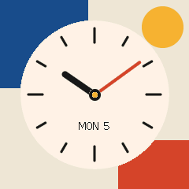 | **bauhaus**: an analog clock in primary colours | Draw hands with `line` items and `sin`/`cos` expressions |
| 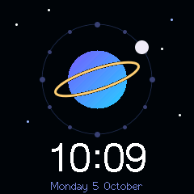 | **orbit**: a planet that orbits once an hour | Move an item along a circle; hour marks from one `repeat` |
| 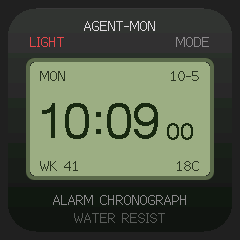 | **retro-lcd**: a 1980s digital watch | Layer opaque text (`bg`) on a panel; `{date.week}` |
| 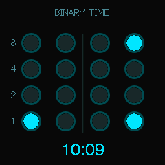 | **binary-clock**: hours and minutes in binary | Compute every bit of a `repeat` of 16 with an expression |
| 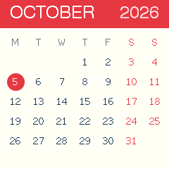 | **calendar**: the month, today circled | A 6-week grid from `{date.wdaynum}`, `{date.mdays}` and one `repeat`; weekday initials from a map |
| 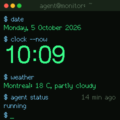 | **terminal**: a shell session | A blinking cursor; status colours from a map; `{age.agent}`. Push `agent` |
| 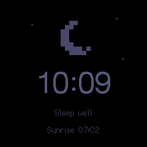 | **night-light**: a dim face for the bedside | `"when": "{theme.night}"`: in the rotation only during night hours |

## Weather, sun and moon

| | Face | Shows how to |
|---|---|---|
| 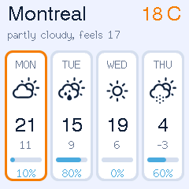 | **forecast-strip**: four days at a glance | `repeat` over `"days"` with `{it.*}`; a day/night palette; a border on today |
| 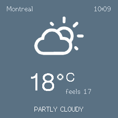 | **weather-poster**: the sky's colour | A palette picked from `{now.code}` by an expression |
| 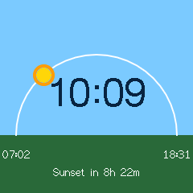 | **sun-arc**: the sun's path across the sky | Place the sun from `{sun.until_set}` and `{sun.daylen}`; a moon at night |
| 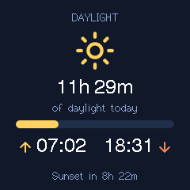 | **daylight**: day length and the next sunset | Hours and minutes from minutes in text expressions; sun or moon by `show` |
| 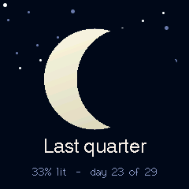 | **moon-phase**: tonight's moon | Shade the moon from `{moon.lit}`; phase names from a map; a starfield `repeat` |
| 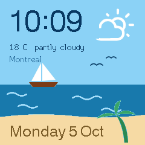 | **seaside**: a beach that turns to night | A day/night palette; the weather icon |
| 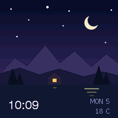 | **night-lake**: mountains under the moon | Layered SVG paths |
| 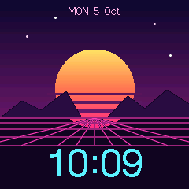 | **synthwave**: an 80s sunset | Gradients on paths and circles |
| 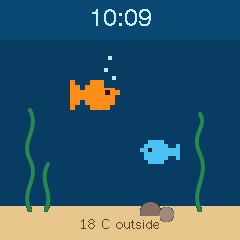 | **aquarium**: fish that swim in place | Animated `sprite` frames with a `bg`, so only they redraw |
| 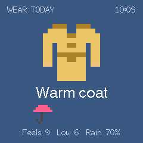 | **what-to-wear**: dress for today's weather | A palette and an outfit `sprite` frame from feels-like bands (°F converted in the expression); an umbrella, sunglasses or a scarf by `show` |
| 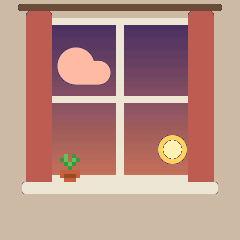 | **sky-window**: the sky through a window | A gradient from a palette picked by time of day (dawn, day, dusk, night) and weather; clouds from `{now.clouds}`; rain, snow or fog `repeat`s; a moon shaded by `{moon.lit}`; walls drawn last to clip the sky |
| 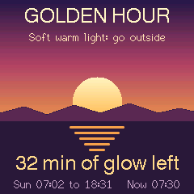 | **golden-hour**: the hour of warm light | `"when"`: only in the hour after sunrise and before sunset, with its own `duration`; the sun sinks with `{sun.until_set}` |

## Agents and work

| | Face | Shows how to |
|---|---|---|
| 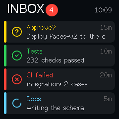 | **agent-inbox**: every agent message | `repeat` over `"msgs"`; a count badge; `"when": "{msg.count}>0"`. Post messages |
| 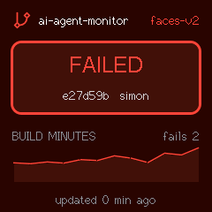 | **ci-pipeline**: the last build | A palette per state; labels from a map; a `spark` of build times. Push `build` (`ok`, `running`, `fail`), `repo`, `branch`, `commit`, `author`, `fails`, `pct`; `mins` with `$history` |
| 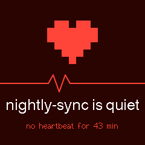 | **heartbeat**: an agent that went quiet | `"when": "{age.beat\|99999}>300"`: the face appears by itself when `beat` stops being pushed. Push `beat` (anything) and `agent` |
| 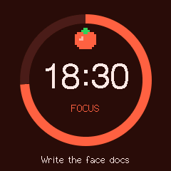 | **pomodoro**: a focus timer | A countdown from a Unix time (`{until}-{time.epoch}`); `"when"` while it runs. Push `until` (Unix time), `len` (seconds), `task`, `mode` (`focus`, `break`) |
| 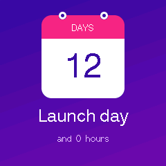 | **countdown**: days to an event | Days and hours from a Unix time; confetti on the day. Push `event`, `at` (Unix time) |
| 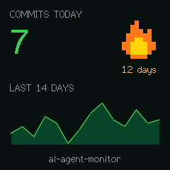 | **commit-streak**: today's commits | `$add` counters; a flickering flame `sprite`; a `spark`. Push `commits` (with `$add`), `streak`, `repo`; `daily` with `$history` |
| 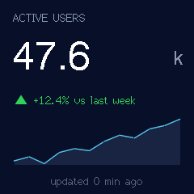 | **kpi**: one number and its trend | `{delta:+}`; colour and arrow by sign; a filled `spark`. Push `label`, `unit`, `delta`; `value` with `$history` |
| 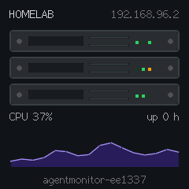 | **homelab**: servers and CPU | Blinking LED sprites; `{net.ip}`, `{net.host}`, `{sys.uptime}`; a `spark`. Push `cpu` with `$history` |
| 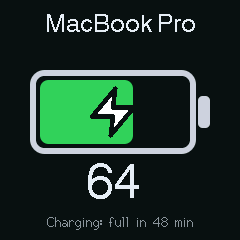 | **power-cell**: a battery | A width from a value; colour by level; a bolt shown while charging. Push `batt`, `charging` (1 or 0), `eta`, `device` |
| 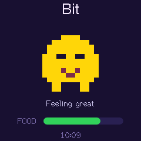 | **pixel-pet**: a pet that needs feeding | A blinking `sprite` coloured by mood through a map; a food bar. Push `pet`, `mood` (`happy`, `hungry`, `sleepy`), `food` (0-100) |
| 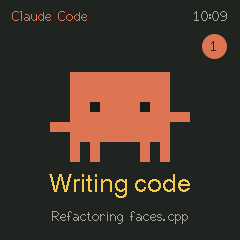 | **claude-mascot**: Claude Code at work | One `sprite` with 9 frames chosen by an expression: typing, cheering, thinking, a slump on failure, asleep at night; a message badge. Push `state` (`thinking`, `working`, `done`, `fail`, or none), `task` |

## Games and worlds

| | Face | Shows how to |
|---|---|---|
| 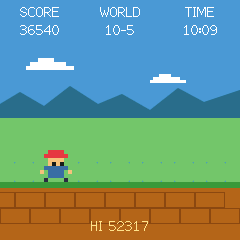 | **retro-runner**: an 8-bit runner that jumps crates | A game loop from `{time.sec}` and `{time.ms}`: crates are opaque `bar`s that step left, the hero `sprite` jumps over them, so nothing else redraws; a day/night palette; the score is the second of the day. Push `hi` |
| 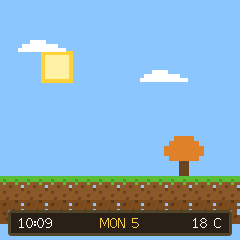 | **block-world**: a blocky world with a day and night | Blocks from `sprite`s in `repeat`s; a square sun and moon on their arcs; snow-capped grass in winter and autumn leaves from `{date.monthnum}`; clouds, rain or snow from the weather; a flickering torch at night |
