# json-render gallery faces

[json-render](https://github.com/vercel-labs/json-render) specs made for a use, to install
from the face gallery (spec 049). A spec describes components (Box, Text, Ring, Sparkline
…) and the clock lays them out itself: no pixel coordinates. They need firmware 2.7.0 or
later. Each carries demo values in its `state`, so it looks complete as soon as it is
installed; push your own values to replace them. The clock holds 40 variables at once,
and pr-queue, the largest, uses 15 of them:

```bash
python plugins/ai-agent-monitor/skills/ai-agent-monitor/scripts/clock.py install home-energy --show
python plugins/ai-agent-monitor/skills/ai-agent-monitor/scripts/clock.py vars solar=4.1 house=0.9 grid=-3.0 battery=81
```

Or install them from the settings page: Integrations → Custom faces → Face gallery, under
**json-render**. To make your own, start from one of these, or ask a model to write one
from the clock's catalog prompt (`GET /api/catalog/prompt`, `clock.py catalog --prompt`).
`samples.json` holds the values used for the pictures. The six specs one folder up are the
compiler's examples (one component of each kind), not gallery faces.

## json-render

| | Face | What feeds it |
|---|---|---|
| 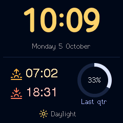 | **sky**: sunrise, sunset and the moon's phase, in day or night colours | Nothing: the clock's own sun and moon times |
| 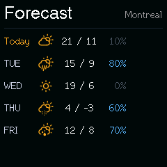 | **week-ahead**: five days of weather, with the chance of rain | Nothing: the clock's own forecast |
| 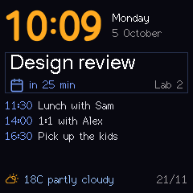 | **today**: the time, the next meeting with a countdown, the agenda and the weather | `meeting`, `room`, `mins` (minutes until it starts; red from 5), `at1`-`at3` and `a1`-`a3` (agenda times and lines), from a calendar script or Home Assistant |
| 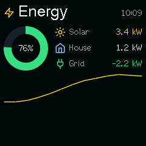 | **home-energy**: solar, house and grid power and the battery, with the day's solar | `solar`, `house`, `grid` (kW; below 0 is exporting, in green), `battery` (%), from Home Assistant over MQTT; push `solar` with `$history` for the line |
| 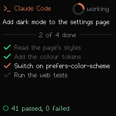 | **agent-session**: what a coding agent is doing: its task, four to-dos ticking off, the tests | `agent`, `state` (`working` shows the spinner), `task`, `todo1`-`todo4`, `done` (how many are done), `passed`, `failed`, from Claude Code hooks |
| 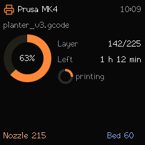 | **printer**: a 3D print's progress, layers, time left and temperatures | `printer`, `file`, `state` (`printing` or `done`), `pct`, `layer`, `layers`, `left`, `nozzle`, `bed`, from Home Assistant (OctoPrint, Bambu, Prusa) |
| 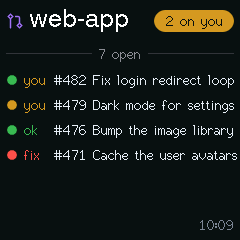 | **pr-queue**: four open pull requests with their review (yours, approved, changes asked) and CI, and how many wait on you | `repo`, `prs` (open), `mine` (waiting on you), `pr1`-`pr4` (number and title), `rev1`-`rev4` (`you`, `ok`, `fix`, `wait`), `ci1`-`ci4` (`pass`, `fail`, `run`), from a script on the GitHub API or an agent's hook |
| 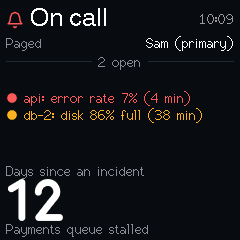 | **on-call**: open alerts coloured by severity, who is paged, days since the last incident; "All quiet" when there are none | `alerts` (how many), `sev1`-`sev3` (`crit`, `warn`, `info`), `alert1`-`alert3`, `paged`, `since` (days), `incident`, from an alerting webhook (Alertmanager, PagerDuty) through MQTT or a script |
| 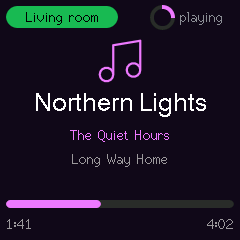 | **now-playing**: the song, artist and album, its position, a spinner while it plays, the speaker | `song`, `artist`, `album`, `player` (`playing` shows the spinner), `played` (0 to 1), `pos`, `len`, `source`, from Home Assistant's media player over MQTT |
| 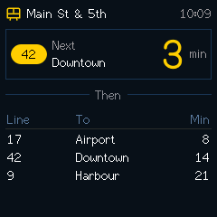 | **departures**: the next bus or train in large type, red when it leaves within 2 minutes, and the three after it in a table | `stop`, `line1`-`line4`, `to1`-`to4`, `min1`-`min4` (minutes), from a small script on your transit agency's GTFS feed |
| 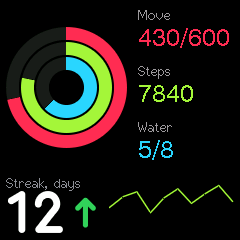 | **activity-rings**: move, steps and water as three rings against their goals, the streak, and steps over the past days | `move` (kcal, goal 600), `steps` (goal 10,000), `water` (glasses, goal 8), `streak` (days), `daily` (push each day's steps with `$history` for the line), from a phone shortcut; change the goals in the spec's Ring `max` |
| 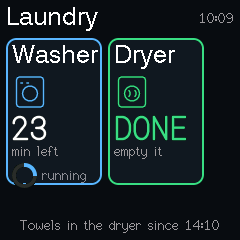 | **laundry**: the washer and the dryer, each off, running (minutes left, a spinner) or done until someone empties it | `washer`, `dryer` (`off`, `running`, `done`), `washerleft`, `dryerleft` (minutes), `note`, from Home Assistant (a smart plug's power) |
