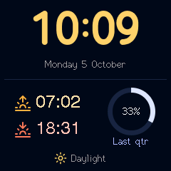
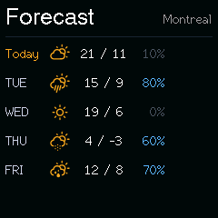
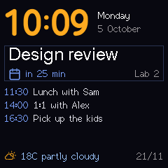
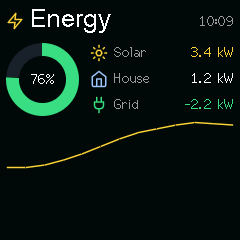
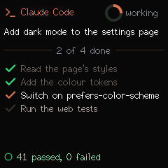
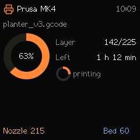

# json-render gallery faces

[json-render](https://github.com/vercel-labs/json-render) specs made for a use, to install
from the face gallery (spec 049). A spec describes components (Box, Text, Ring, Sparkline
…) and the clock lays them out itself: no pixel coordinates. They need firmware 2.7.0 or
later. Each carries demo values in its `state`, so it looks complete as soon as it is
installed; push your own values to replace them:

```bash
python plugins/ai-agent-monitor/skills/ai-agent-monitor/scripts/clock.py install home-energy --show
python plugins/ai-agent-monitor/skills/ai-agent-monitor/scripts/clock.py vars solar=4.1 house=0.9 grid=-3.0 battery=81
```

Or install them from the settings page: Integrations → Custom faces → Face gallery, under
**json-render**. To make your own, start from one of these, or ask a model to write one
from the clock's catalog prompt (`GET /api/catalog/prompt`, `clock.py catalog --prompt`).
`samples.json` holds the values used for the pictures. The six specs one folder up are the
compiler's examples (one component of each kind), not gallery faces.

## json-render

| | Face | What feeds it |
|---|---|---|
|  | **sky**: sunrise, sunset and the moon's phase, in day or night colours | Nothing: the clock's own sun and moon times |
|  | **week-ahead**: five days of weather, with the chance of rain | Nothing: the clock's own forecast |
|  | **today**: the time, the next meeting with a countdown, the agenda and the weather | `meeting`, `room`, `mins` (minutes until it starts; red from 5), `at1`-`at3` and `a1`-`a3` (agenda times and lines), from a calendar script or Home Assistant |
|  | **home-energy**: solar, house and grid power and the battery, with the day's solar | `solar`, `house`, `grid` (kW; below 0 is exporting, in green), `battery` (%), from Home Assistant over MQTT; push `solar` with `$history` for the line |
|  | **agent-session**: what a coding agent is doing: its task, four to-dos ticking off, the tests | `agent`, `state` (`working` shows the spinner), `task`, `todo1`-`todo4`, `done` (how many are done), `passed`, `failed`, from Claude Code hooks |
|  | **printer**: a 3D print's progress, layers, time left and temperatures | `printer`, `file`, `state` (`printing` or `done`), `pct`, `layer`, `layers`, `left`, `nozzle`, `bed`, from Home Assistant (OctoPrint, Bambu, Prusa) |
